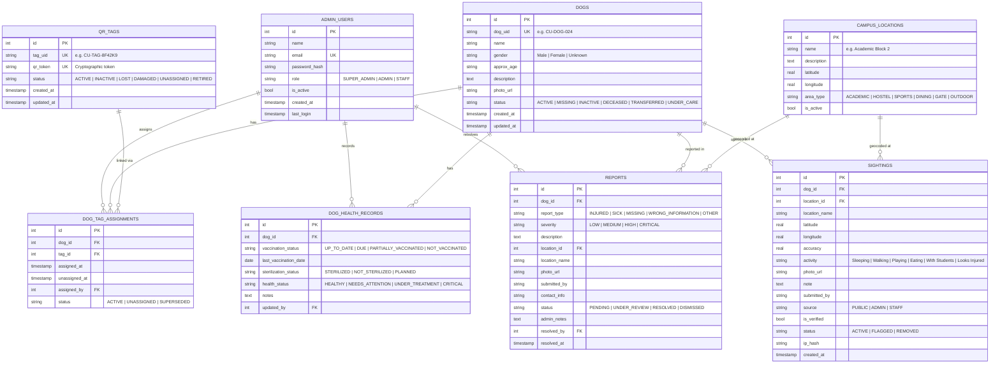

# Chandigarh University — Campus Dog Digital Identity System (DOGCU)
## Production Backend Architecture & Complete System Specification

A resilient, scalable, and secure backend architecture designed for **Chandigarh University** to register, monitor, and care for campus dogs through static physical QR neck bands, dynamic community sightings, emergency injury reporting, and comprehensive administrative animal welfare tools.

---

## 1. System Architecture & Fundamental Principles

```
  ┌─────────────────────────────────┐
  │  Physical Collar QR Tag         │
  │  e.g. CU-TAG-8F42K9             │
  └────────────────┬────────────────┘
                   │ Encodes permanent canonical URL:
                   │ https://ourdomain.com/t/CU-TAG-8F42K9
                   ▼
  ┌─────────────────────────────────┐
  │  Permanent QR Tag Record        │
  │  Table: qr_tags                 │
  └────────────────┬────────────────┘
                   │ Resolves current active link
                   ▼
  ┌─────────────────────────────────┐
  │  Dog-Tag Assignment             │
  │  Table: dog_tag_assignments     │
  └────────────────┬────────────────┘
                   │ Points to currently assigned dog
                   ▼
  ┌─────────────────────────────────┐
  │  Master Dog Record              │ ◄────── Managed strictly by Admin
  │  Table: dogs (CU-DOG-024)       │
  └───────┬─────────────────┬───────┘
          │                 │
          ▼                 ▼
  ┌───────────────┐ ┌──────────────────────────────────────────────┐
  │ Health Record │ │ Sighting History (Table: sightings)          │
  │ Official info │ │ 10:00 AM → Hostel Area (PUBLIC)              │
  └───────────────┘ │ 11:30 AM → Central Lawn (PUBLIC)             │
                    │ 12:45 PM → Academic Block 2 (PUBLIC)         │
                    └──────────────────────┬───────────────────────┘
                                           │ Dynamic query
                                           ▼
                    ┌──────────────────────────────────────────────┐
                    │ Public Dog Profile Response                  │
                    │ "Last Spotted: Academic Block 2 (12m ago)"   │
                    └──────────────────────────────────────────────┘
```

### Core Architecture Rules

1. **The Physical QR is Static & Permanent**:
   - The QR code contains only the permanent tag URL: `https://ourdomain.com/t/CU-TAG-XXXXXX`.
   - The QR code **NEVER** embeds dog profile data directly.
   - Changing a dog's age, name, photo, status, or health **never** requires printing a new QR code.
2. **Dog ID and Tag ID are Separate Entities**:
   - `dog_uid`: `CU-DOG-024` (identifies Bruno the dog).
   - `tag_uid`: `CU-TAG-8F42K9` (identifies the physical collar tag).
   - Related through the `dog_tag_assignments` ledger.
3. **Historical Auditability**:
   - Physical tags can be reassigned between dogs over time.
   - Previous assignments are never deleted; they are marked `SUPERSEDED` or `UNASSIGNED` with explicit timestamps (`unassigned_at`).
4. **Community Sightings Do Not Overwrite Master Data**:
   - Public users cannot edit a dog's official name, ID, vaccination record, or photo.
   - Public users create individual, timestamped `sightings` records (`source = 'PUBLIC'`).
   - The system dynamically computes the dog's public "Last Spotted" location from the newest verified sighting.

---

## 2. Relational Database Design

The system runs on SQLite with Write-Ahead Logging (`WAL` mode), foreign key enforcement (`PRAGMA foreign_keys = ON`), and connection pooling, ensuring ACID transactions and seamless portability to PostgreSQL or MySQL.



---

## 3. QR Resolution Workflow

Endpoint: `GET /t/:tagUid` (e.g. `/t/CU-TAG-8F42K9`)

```
                      [ Scan QR Tag ]
                            │
                            ▼
              Query database: qr_tags table
                            │
               ┌────────────┴────────────┐
             Exists?                   No ──► HTTP 404
               │                              "QR TAG NOT REGISTERED"
              Yes
               ▼
             Status == 'ACTIVE'?       No ──► HTTP 403
               │                              "THIS TAG IS CURRENTLY INACTIVE"
              Yes
               ▼
        Find Active Assignment
        in dog_tag_assignments
               │
               ┌────────────┴────────────┐
             Assigned?                 No ──► HTTP 404
               │                              "THIS TAG IS NOT CURRENTLY ASSIGNED"
              Yes
               ▼
        Fetch Associated Dog (dogs table)
               │
               ▼
    [ Resolve To Dog Profile: /dog/CU-DOG-024 ]
    - Browser: HTTP 302 Redirect to /dog/:dogUid
    - API / JSON: HTTP 200 with dog UID and redirect link
```

### Safety and Clean Error Guarantees:
- **Never reveals previous dog assignment** if tag is inactive or unassigned.
- **Never leaks internal database schema or stack traces**.
- **A QR scan leads ONLY to that exact dog** — never to a general catalog or unrelated dogs.

---

## 4. API Reference

### 🌐 Public Endpoints (No Authentication Required)

| Method | Endpoint | Description |
|---|---|---|
| `GET` | `/t/:tagUid` | Permanent QR tag scanner entrypoint (Redirects browser or returns JSON). |
| `GET` | `/api/dogs/:dogUid` | Public dog profile with dynamic `last_seen`, health overview, and active tag. |
| `GET` | `/api/dogs/:dogUid/sightings` | Chronological public sighting history for a dog (paginated). |
| `POST` | `/api/dogs/:dogUid/sightings` | Submit a public location sighting ("I saw this dog"). Rate limited. |
| `POST` | `/api/dogs/:dogUid/reports` | Submit an emergency / injury / health report. Rate limited. |
| `GET` | `/api/locations` | List active Chandigarh University campus locations. |
| `POST` | `/api/upload` | Upload image (max 5MB, JPG/PNG/WEBP). |

#### Public Dog Profile Response Sample (`GET /api/dogs/CU-DOG-024`)
```json
{
  "dog_uid": "CU-DOG-024",
  "name": "Bruno",
  "gender": "Male",
  "approx_age": "3 years",
  "description": "Friendly golden-brown indie dog near Block 2.",
  "photo_url": "https://example.com/bruno.jpg",
  "status": "ACTIVE",
  "last_seen": {
    "location": "Academic Block 2 (Computing & AI)",
    "timestamp": "2026-09-28 13:38:00",
    "time_ago": "14 minutes ago",
    "activity": "Resting",
    "photo_url": null
  },
  "health_overview": {
    "vaccination_status": "UP_TO_DATE",
    "last_vaccination_date": "2026-03-15",
    "sterilization_status": "STERILIZED",
    "health_status": "HEALTHY"
  },
  "active_tag": "CU-TAG-8F42K9"
}
```

---

### 🔐 Administrative Endpoints (Bearer Token Protected)

#### Authentication (`/api/auth`)
| Method | Endpoint | Role | Description |
|---|---|---|---|
| `POST` | `/api/auth/login` | Public | Authenticate with email/password; returns JWT. |
| `GET` | `/api/auth/me` | Staff+ | Retrieve current user profile and role. |
| `POST` | `/api/auth/logout` | Staff+ | Acknowledge session termination. |

#### Dashboard (`/api/admin/dashboard`)
| Method | Endpoint | Role | Description |
|---|---|---|---|
| `GET` | `/api/admin/dashboard` | Staff+ | Operational counters (total dogs, active tags, 24h sightings, open reports, at-risk dogs). |

#### Dogs Management (`/api/admin/dogs`)
| Method | Endpoint | Role | Description |
|---|---|---|---|
| `GET` | `/api/admin/dogs` | Staff+ | List dogs with search, status filters, and stats. |
| `POST` | `/api/admin/dogs` | Admin+ | Register new dog with auto-generated `CU-DOG-XXX`. |
| `GET` | `/api/admin/dogs/:id` | Staff+ | Full operational dossier (assignments, health, sightings, reports). |
| `PATCH` | `/api/admin/dogs/:id` | Admin+ | Update master info (name, age, photo). Does **not** change QR tag. |
| `DELETE` | `/api/admin/dogs/:id` | Admin+ | Soft-delete / mark INACTIVE. Preserves all history. |
| `GET` | `/api/admin/dogs/:id/health` | Staff+ | List medical history records for a dog. |
| `POST` | `/api/admin/dogs/:id/health` | Admin+ | Add official medical/vaccination record. |
| `PATCH` | `/api/admin/dogs/:id/health/:recordId` | Admin+ | Update existing medical record. |

#### QR Tags Management (`/api/admin/tags`)
| Method | Endpoint | Role | Description |
|---|---|---|---|
| `GET` | `/api/admin/tags` | Staff+ | List all QR tags with current assignments. |
| `POST` | `/api/admin/tags` | Admin+ | Generate `CU-TAG-XXXXXX`, secure token, and static QR code. |
| `GET` | `/api/admin/tags/:id` | Staff+ | Tag details, active dog, and complete assignment audit trail. |
| `PATCH` | `/api/admin/tags/:id` | Admin+ | Update tag status (`ACTIVE`, `INACTIVE`, `LOST`, `DAMAGED`, `RETIRED`). |
| `POST` | `/api/admin/tags/:id/assign` | Admin+ | Assign tag to dog. Supersedes previous assignment with audit log. |
| `POST` | `/api/admin/tags/:id/unassign` | Admin+ | Unassign tag from dog. Marks unassigned with timestamp. |
| `GET` | `/api/admin/tags/:id/history` | Staff+ | Chronological history of all dogs assigned to this physical tag. |
| `GET` | `/api/admin/tags/:id/qr-image` | Public | Stream PNG image of the QR code for printing. |
| `GET` | `/api/admin/tags/:id/printable-badge` | Public | Printable HTML collar badge template with cutting guide. |

#### Sightings & Telemetry Moderation (`/api/admin/sightings`)
| Method | Endpoint | Role | Description |
|---|---|---|---|
| `GET` | `/api/admin/sightings` | Staff+ | Audit sightings with IP hash, geolocation accuracy, and source. |
| `GET` | `/api/admin/sightings/:id` | Staff+ | Single sighting audit details. |
| `PATCH` | `/api/admin/sightings/:id` | Admin+ | Moderate sighting (flag spam, verify, or remove from public view). |

#### Emergency Reports (`/api/admin/reports`)
| Method | Endpoint | Role | Description |
|---|---|---|---|
| `GET` | `/api/admin/reports` | Staff+ | Filter by status (`PENDING`, `RESOLVED`), severity, and type. |
| `GET` | `/api/admin/reports/:id` | Staff+ | Full report view including rescue contact info. |
| `PATCH` | `/api/admin/reports/:id` | Admin+ | Update ticket status and record admin resolution notes. |

#### Campus Locations (`/api/admin/locations`)
| Method | Endpoint | Role | Description |
|---|---|---|---|
| `GET` | `/api/admin/locations` | Staff+ | List all campus geofence reference locations. |
| `POST` | `/api/admin/locations` | Admin+ | Add new campus building or lawn. |
| `PATCH` | `/api/admin/locations/:id` | Admin+ | Update location coordinates or active status. |

#### Admin User Accounts (`/api/admin/users`)
| Method | Endpoint | Role | Description |
|---|---|---|---|
| `GET` | `/api/admin/users` | SuperAdmin | List administrative users. |
| `POST` | `/api/admin/users` | SuperAdmin | Provision new `SUPER_ADMIN`, `ADMIN`, or `STAFF` account. |
| `PATCH` | `/api/admin/users/:id` | SuperAdmin | Update role, active status, or reset credentials. |

---

## 5. Security & Anti-Abuse Measures

1. **Password Hashing**: Bcrypt with cryptographic salt rounds.
2. **Token Security**: Signed HS256 JSON Web Tokens with expiry and active user validation.
3. **Public Anonymity with Privacy-Preserving Rate Limiting**:
   - Public users do not require accounts to report sightings or emergencies.
   - Client IPs are hashed with a server-side salt (`hash_client_ip`) so raw IPs are never stored in sighting logs.
   - Sliding-window rate limiter prevents spam and DDoS attacks (15 sightings/min, 10 reports/min).
4. **Location Privacy**:
   - Public API returns approximate campus block names (`Academic Block 2`) rather than raw GPS coordinates to prevent harassment.
   - Raw precision GPS coordinates remain accessible exclusively to authenticated rescue teams.
5. **Security Headers**:
   - `X-Content-Type-Options: nosniff`
   - `X-Frame-Options: DENY`
   - `X-XSS-Protection: 1; mode=block`
   - `Referrer-Policy: strict-origin-when-cross-origin`

---

## 6. Verification of the 12 Mandatory Test Cases

All 12 test cases specified in Section 47 were tested and validated with the automated test suite:

| Test Case | Description | Result |
|---|---|---|
| **Test 1** | Create Bruno (`CU-DOG-024`) via admin API | **PASS** |
| **Test 2** | Create physical QR tag (`CU-TAG-8F42K9`) | **PASS** |
| **Test 3** | Assign QR tag to Bruno | **PASS** |
| **Test 4** | Open `/t/CU-TAG-8F42K9` and verify resolution to Bruno | **PASS** |
| **Test 5** | Change Bruno's info; verify SAME QR still opens Bruno with updated info | **PASS** |
| **Test 6** | Public user submits Bruno at Academic Block 2; verify sighting created | **PASS** |
| **Test 7** | Another user submits Bruno at Central Lawn; verify both sightings in history | **PASS** |
| **Test 8** | Verify Bruno's public page shows newest valid sighting as latest location | **PASS** |
| **Test 9** | Create Milo (`CU-DOG-025`) with different QR; verify Milo's QR does NOT open Bruno | **PASS** |
| **Test 10** | Deactivate Bruno's QR; verify QR returns inactive message and hides dog | **PASS** |
| **Test 11** | Unassign Bruno's tag; verify tag returns unassigned status | **PASS** |
| **Test 12** | Reassign same tag to another dog; verify QR resolves to new dog while preserving old assignment history | **PASS** |

Run the test suite anytime:
```bash
./test.sh
```

---

## 7. Default Demo Seed Data

### Admin Accounts
- **Super Administrator**: `admin@cumail.in` / `Admin@12345`
- **Campus Rescue Staff**: `staff@cumail.in` / `Staff@12345`

### Registered Dogs & QR Tags
- **Bruno**: `CU-DOG-024` → QR Tag: `CU-TAG-8F42K9`
- **Milo**: `CU-DOG-025` → QR Tag: `CU-TAG-9M31P2`
- **Luna**: `CU-DOG-026` → QR Tag: `CU-TAG-4K77X1`
- **Spare Unassigned Tag**: `CU-TAG-SPAREE`

---

## 8. Quick Start Guide

### Start the Server
```bash
./run.sh
```
The server will boot at: **`http://localhost:8000`**

### Access Interactive Documentation
- **Swagger UI**: `http://localhost:8000/docs`
- **ReDoc**: `http://localhost:8000/redoc`
- **Bruno Live Public API**: `http://localhost:8000/api/dogs/CU-DOG-024`
- **Physical QR Tag Scan**: `http://localhost:8000/t/CU-TAG-8F42K9`
- **Printable Collar Tag**: `http://localhost:8000/api/admin/tags/1/printable-badge`
